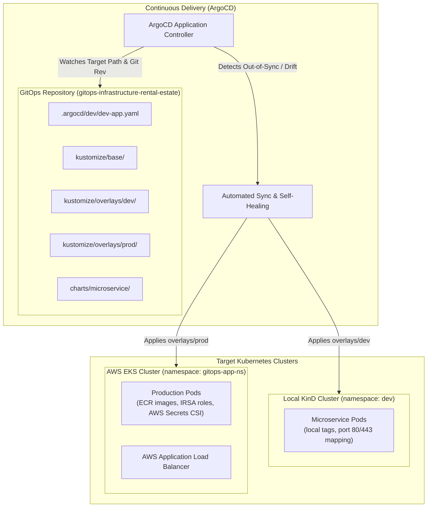

# 🚀 GitOps Infrastructure & Delivery Repository

This repository is the **declarative single source of truth** for all Kubernetes workloads in the **Estate Rental** ecosystem. Continuous deployment, drift detection, and cluster reconciliation are managed automatically using **ArgoCD**, **Kustomize**, and a universal **Helm** microservice chart.

---

## 🏛 GitOps Architecture



---

## 📂 Repository Directory Structure & File Index

```text
gitops_repo_estate_rental/
├── .argocd/
│   └── dev/
│       └── dev-app.yaml               # ArgoCD Application definition for dev
├── charts/
│   └── microservice/                  # Universal microservice Helm chart
│       ├── Chart.yaml                 # Helm chart metadata
│       ├── values.yaml                # Default values (replicas, probes, resources)
│       └── templates/                 # Reusable Kubernetes templates
│           ├── _helpers.tpl           # Go template helpers (labels, names)
│           ├── configmap.yaml         # ConfigMap template
│           ├── deployment.yaml        # Deployment spec (containers, CSI mounts, env)
│           ├── ingress.yaml           # Ingress manifest with ALB annotations
│           ├── secretproviderclass.yaml# AWS Secrets Store CSI integration
│           ├── service.yaml           # Service manifest (ClusterIP / NodePort)
│           └── serviceaccount.yaml    # ServiceAccount with IRSA annotations
├── kind_cluster_config.yaml           # Multi-node local KinD cluster configuration
└── kustomize/
    ├── base/                          # Shared baseline configurations
    │   ├── kustomization.yaml         # Aggregates services and networking
    │   ├── networking/                # Ingress routing rules
    │   └── services/                  # Base Helm chart invocations
    │       ├── authorization-service/
    │       ├── config-service/
    │       ├── frontend/
    │       ├── gateway-estate-rental-service/
    │       └── user-management-service/
    └── overlays/                      # Environment-specific overrides
        ├── dev/                       # Local development overlay
        │   ├── kustomization.yaml
        │   └── namespace.yaml
        └── prod/                      # AWS EKS production overlay
            ├── authorization-service-values.yaml
            ├── config-service-values.yaml
            ├── frontend-values.yaml
            ├── gateway-service-values.yaml
            ├── kustomization.yaml
            ├── namespace.yaml
            └── user-management-service-values.yaml
```

---

## 📑 File-by-File Breakdown

### 1. Cluster & ArgoCD Configuration

| File | Purpose |
| :--- | :--- |
| `kind_cluster_config.yaml` | Defines a 2-node local Kubernetes cluster (`dev-cluster`) with 1 control-plane and 1 worker node. Binds host ports 80 and 443 to container ports for local Ingress traffic, and sets `disableDefaultCNI: true` to support custom CNIs (e.g., Cilium). |
| `.argocd/dev/dev-app.yaml` | Declares the ArgoCD `Application` resource named `estate-rental-dev`. Monitors the Git repository on the `main` branch targeting `kustomize/overlays/dev`, synchronizing into destination namespace `dev` with automated self-healing and pruning. |

---

### 2. Universal Helm Chart (`charts/microservice/`)

Eliminates manifest duplication across microservices by abstracting standard Kubernetes deployment patterns into a single reusable chart.

| File | Purpose |
| :--- | :--- |
| `Chart.yaml` | Defines chart metadata (`name: microservice`, `version: 0.1.0`, `apiVersion: v2`). |
| `values.yaml` | Default configuration for replica count (`1`), image pull policy (`IfNotPresent`), default HTTP port (`8080`), probes, and service type (`ClusterIP`). |
| `templates/_helpers.tpl` | Contains reusable Go template functions for computing normalized fullnames, common metadata labels, and match selectors. |
| `templates/deployment.yaml` | Renders the primary `apps/v1 Deployment`. Configures container ports, environment variables (`env`), configmap references (`envFrom`), and conditionally mounts AWS Secrets Store CSI volumes when enabled. |
| `templates/service.yaml` | Renders the Kubernetes `Service` to route traffic to the pods over TCP. |
| `templates/ingress.yaml` | Renders the Kubernetes `Ingress` rule, supporting custom paths, hosts, and ingress class annotations. |
| `templates/serviceaccount.yaml` | Renders the Kubernetes `ServiceAccount`, conditionally annotating it with AWS IAM Role ARNs (`eks.amazonaws.com/role-arn`) for IRSA. |
| `templates/secretproviderclass.yaml` | Renders the `secrets-store.csi.x-k8s.io` `SecretProviderClass` resource to fetch secrets from AWS Secrets Manager directly into the pod filesystem. |
| `templates/configmap.yaml` | Renders a `ConfigMap` storing non-sensitive configuration keys passed in values. |

---

### 3. Kustomize Base & Overlays (`kustomize/`)

Employs Kustomize with the Helm chart generator (`helmCharts`) to compose environments cleanly without template copying.

| Folder / File | Purpose |
| :--- | :--- |
| `kustomize/base/kustomization.yaml` | Root base aggregator pulling in all 5 microservice bases and shared networking definitions. |
| `kustomize/base/networking/ingress.yaml` | Core Ingress routing rules directing web traffic (`/`) to the frontend and API requests (`/api/**`) to the API Gateway. |
| `kustomize/base/services/*/kustomization.yaml` | Declares a local Helm release for each respective service referencing `../../../../charts/microservice` and applies local `values-dev.yaml`. |
| `kustomize/overlays/dev/` | Configures the `dev` namespace overlay for local KinD execution. Uses local Docker tags (`tag: local`), internal DNS service URLs, and port mappings. |
| `kustomize/overlays/prod/` | Production overlay for AWS EKS in namespace `gitops-app-ns`. Injects ECR repository paths, IRSA role ARNs for Secrets Manager, production Spring active profiles, and ingress annotations for the AWS Application Load Balancer. |

---

## 🛠 Quick Start & Deployment

### Run Locally on KinD
```bash
# 1. Create KinD cluster
kind create cluster --config kind_cluster_config.yaml

# 2. Build and load service images
# (from project root) ./load_images.sh

# 3. Apply the dev overlay
kubectl apply -k kustomize/overlays/dev
```

### Deploy to Production via ArgoCD
```bash
# Register the ArgoCD Application
kubectl apply -f .argocd/dev/dev-app.yaml
```

